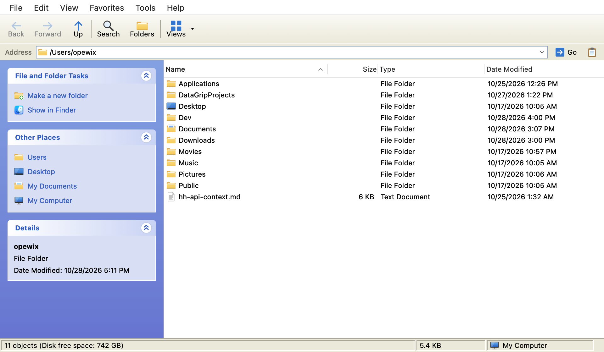

# WExplorer

A Windows XP-style file manager for macOS. The Luna look, the task pane, the folder tree and the
address bar you remember — running natively on your Mac.



## Features

- **Classic layout:** menu bar, toolbar with Back / Forward / Up / Search / Folders / Views,
  address bar with autocomplete, status bar.
- **Left pane:** switch between the task pane (File and Folder Tasks, Other Places, Details) and
  the folder tree.
- **Views:** Thumbnails, Tiles, Icons, List and Details, with QuickLook thumbnails.
- **File operations:** copy, cut & paste, drag & drop to and from Finder, rename in place (F2),
  move to Trash, undo (⌘Z), name conflict dialog, progress window.
- **Archives:** extract and create zip, 7z and tar out of the box. If
  [7-Zip](https://www.7-zip.org/) is installed (`brew install sevenzip`), WExplorer can use it for
  more formats and for creating password-protected archives.
- **Search** powered by Spotlight, **Favorites**, **Properties** window.
- **Languages:** English and Russian (Tools → Language).
- macOS keyboard shortcuts (⌘C / ⌘X / ⌘V) instead of Ctrl.

## Install

1. Download `wexplorer-<version>.dmg` from [Releases](https://github.com/opewix/wexplorer/releases).
2. Open it and drag **WExplorer** to **Applications**.
3. The app is not notarized by Apple, so macOS blocks the first launch. Open it once, then go to
   **System Settings → Privacy & Security** and click **Open Anyway**. Or run:

   ```sh
   xattr -dr com.apple.quarantine /Applications/WExplorer.app
   ```

Requires macOS 13 Ventura or later. To browse protected folders, grant WExplorer
**Full Disk Access** in System Settings.

## Build from source

Only the Swift toolchain is needed (Xcode Command Line Tools), no Xcode project.

```sh
swift build                          # debug build
./scripts/bundle.sh                  # build/WExplorer.app
VERSION=0.7 ./scripts/make-dmg.sh    # build/wexplorer-0.7.dmg
```

To add a language, see [Localization](Sources/WExplorer/Localization/README.md).

## License

[MIT](LICENSE). Free to use, modify and distribute; provided as is, without any warranty.

## Disclaimer

WExplorer is an independent project, not affiliated with or endorsed by Microsoft. Windows and
Windows XP are trademarks of Microsoft Corporation. The app ships no Microsoft code, icons or
fonts: all graphics are drawn by the app itself.
